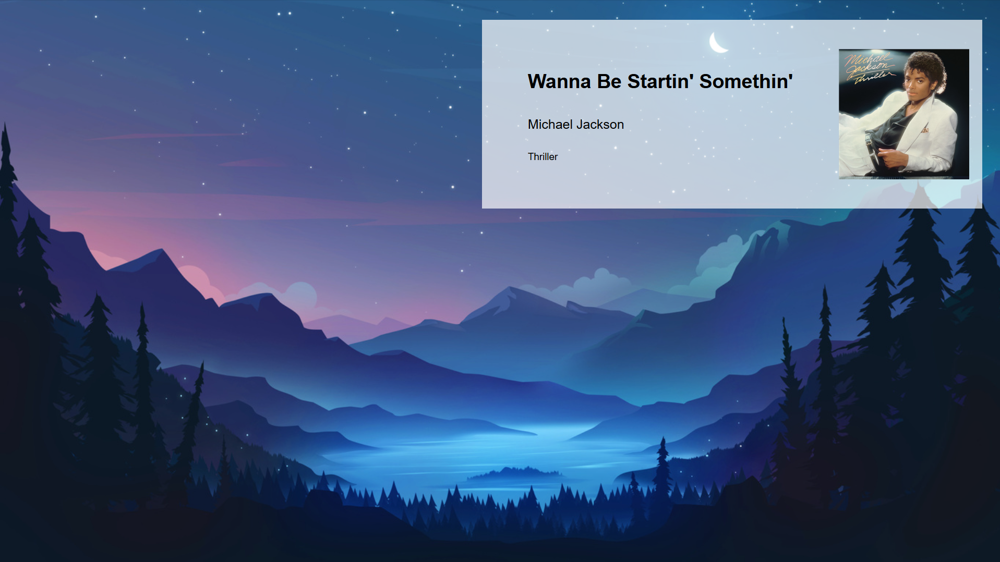

### Lively Wallpaper Project

Essentially, this is a desktop wallpaper designed for **Lively Wallpaper**, built using HTML, CSS, and JavaScript.

## Requirements

To run this project, you need to install Lively Wallpaper.

You can get it from the [official GitHub repository](https://github.com/lively-community/lively), or, even more easily, search for **Lively Wallpaper** in the Microsoft Store, which comes pre-installed on Windows.

Once you're in the app, tap the + button, enter this repo, and check out your wallpaper!

If you'd like to customize it, tap the three-dot menu on the wallpaper; you can then add an .mp4 or .mov video, or any type of image (just make sure it’s 1920x1080p or has a similar aspect ratio).

## Features

* Supports both videos and images.
* Reacts dynamically when you change songs or videos.
* Built using HTML, CSS, and JavaScript.

## AI Usage

AI is used only to help identify potential errors. All code is written by humans.

## Contribution

Feel free to send suggestions for improving this wallpaper and/or the original [Repository](https://github.com/lively-community/lively)!

## License

This project is licensed under the **MIT License**. Anyone is free to use, modify, distribute, and even sell software incorporating this project, subject to the license terms.

:D